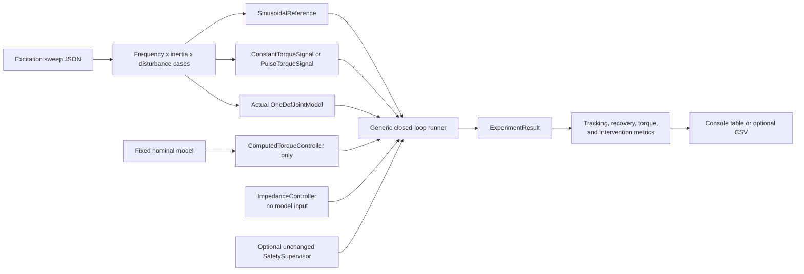

# Excitation and Disturbance Robustness Evaluation

## Purpose and status

This implemented deterministic study extends the first model-mismatch sweep to
ask how the fixed-gain impedance and computed-torque baselines respond to
increasing sinusoidal reference frequency, actual-plant inertia mismatch, and
finite external torque pulses. It is an engineering study of the scalar
mathematical model, not a safety, biomechanical, medical, or clinical
validation.

The study reuses the existing plant, controllers, safety supervisor, experiment
runner, records, and controller-independent metrics. It adds no controller
logic, plant equations, randomness, or runtime dependency.

## Why frequency follows inertia mismatch

For the configured reference

```text
q_ref(t) = offset + A sin(2 pi f t)
```

the analytic acceleration is

```text
q_ref_ddot(t) = -A (2 pi f)^2 sin(2 pi f t)
```

and its peak magnitude is `A (2 pi f)^2`. Increasing frequency therefore
raises desired acceleration quadratically. Computed torque multiplies that
acceleration by its fixed nominal inertia, so an actual-versus-nominal inertia
difference becomes more consequential as excitation increases. Impedance
control does not use acceleration or a plant model, but it must still correct
faster position and velocity errors with unchanged gains.

With the fixed `0.2 rad` amplitude, configured peak reference accelerations are:

| Frequency | Peak reference acceleration |
| ---: | ---: |
| 0.25 Hz | 0.493 rad/s² |
| 0.50 Hz | 1.974 rad/s² |
| 0.75 Hz | 4.441 rad/s² |
| 1.00 Hz | 7.896 rad/s² |

## Implemented architecture



`run_closed_loop_experiment()` accepts an optional deterministic
`TorqueSignal`. It evaluates the signal at the current recorded timestamp and
places the result in `JointTorques.disturbance_torque_n_m`. Controllers still
receive only `JointState` and `JointReference`; they do not observe or cancel
the disturbance directly. Omitting the signal retains the scenario's existing
constant disturbance exactly.

## Torque signals and pulse semantics

- `ConstantTorqueSignal` returns one finite torque for every valid time.
- `PulseTorqueSignal` returns its configured torque over the half-open interval
  `[start_time_s, start_time_s + duration_s)` and zero outside it.

Boundary comparisons use a `1e-12 s` absolute tolerance so decimal fixed-step
timestamps represent the intended exclusive end despite binary roundoff.

The configuration applies a `+1.0 N m` or `-1.0 N m` pulse from `2.00 s`
through, but not including, `2.25 s`. The no-disturbance profile remains zero
throughout. These values are illustrative mathematical disturbances, not human
interaction torques or safety thresholds.

At the experiment's final sample, the disturbance signal is evaluated and
recorded consistently with other sample fields, but no subsequent integration
occurs.

## Evaluation grid and fairness

`configs/robustness/excitation_disturbance_sweep.json` defines:

- frequencies: `0.25`, `0.50`, `0.75`, and `1.00 Hz`;
- actual inertia factors: `0.8`, `1.0`, and `1.2` times nominal;
- fixed reference amplitude and offset: `0.2 rad` and `0 rad`;
- profiles: none, positive pulse, and negative pulse;
- fixed pulse magnitude and timing;
- recovery tolerance `0.05 rad` and dwell duration `0.25 s`; and
- the existing safety configuration, enabled for the primary study.

The cross-product is 36 cases per controller and 72 controller experiments per
mode. For corresponding controller cases, actual plant, reference, inertia,
disturbance, initial state, timing, human torque, gains, and safety limits are
identical. Gains remain `Kp = 20 N m/rad` and `Kd = 4 N m s/rad`.

The computed-torque controller is constructed once with the unchanged nominal
model. Only the separately constructed actual plant inertia changes.
Impedance control receives no nominal or actual model object.

## Metrics and recovery definition

The study reuses tracking RMSE, requested/applied torque peaks, intervention
count and sample fraction, and maximum torque modification. It adds:

- **Peak absolute tracking error:** maximum recorded
  `abs(actual angle - reference angle)`.
- **Disturbance recovery time:** beginning at the first sample at or after pulse
  end, the earliest tracking-error entry into the inclusive tolerance band that
  remains inside the band at every recorded fixed-step sample through a sample
  at least one dwell duration later. The reported time is relative to pulse
  end.

If insufficient experiment time remains or no qualifying dwell occurs,
recovery is explicitly absent. No-disturbance cases use `not applicable`, not a
failed-recovery value. This is a sample-defined metric: it does not prove
continuous-time behavior between samples and does not filter the data.

The metric uses absolute tracking error, so a high-frequency case can fail the
criterion because its baseline periodic tracking error does not remain inside
the band, even after the pulse transient has dissipated. It is therefore a
combined tracking-and-recovery measure rather than an isolated estimate of the
pulse response.

## Results

The tables report the worst RMSE and peak error among all inertia/disturbance
cases at each frequency. Failed recovery counts cover the six pulse cases per
frequency and exclude no-disturbance cases.

### Primary supervised evaluation

| Controller | Frequency | Worst RMSE | Worst peak error | Failed recoveries | Max interventions |
| --- | ---: | ---: | ---: | ---: | ---: |
| Impedance | 0.25 Hz | 0.029967 rad | 0.050382 rad | 0/6 | 0 |
| Impedance | 0.50 Hz | 0.064815 rad | 0.100882 rad | 0/6 | 121 |
| Impedance | 0.75 Hz | 0.182372 rad | 0.341529 rad | 6/6 | 328 |
| Impedance | 1.00 Hz | 0.166058 rad | 0.300432 rad | 6/6 | 334 |
| Computed torque | 0.25 Hz | 0.020940 rad | 0.050491 rad | 0/6 | 0 |
| Computed torque | 0.50 Hz | 0.041716 rad | 0.104040 rad | 0/6 | 16 |
| Computed torque | 0.75 Hz | 0.107949 rad | 0.214198 rad | 4/6 | 289 |
| Computed torque | 1.00 Hz | 0.121716 rad | 0.213270 rad | 5/6 | 339 |

The supervised impedance worst RMSE is `0.182372 rad` at `0.75 Hz`, nominal
inertia, and the negative pulse. The computed-torque worst RMSE is
`0.121716 rad` at `1.00 Hz`, `1.2x` inertia, and the negative pulse.

Impedance's longest successful recovery is `0.810 s`; it has 12 failed pulse
recoveries, all at `0.75` or `1.00 Hz`. Computed torque's longest successful
recovery is `0.730 s`; it has nine supervised failures. Computed torque is
usually more accurate in this grid, but not in every corresponding case—for
example, impedance has lower RMSE in the `0.50 Hz`, `0.8x` inertia cases.

### Unsupervised diagnostic evaluation

| Controller | Frequency | Worst RMSE | Worst peak error | Failed recoveries |
| --- | ---: | ---: | ---: | ---: |
| Impedance | 0.25 Hz | 0.029967 rad | 0.050382 rad | 0/6 |
| Impedance | 0.50 Hz | 0.059284 rad | 0.085897 rad | 0/6 |
| Impedance | 0.75 Hz | 0.148182 rad | 0.245560 rad | 6/6 |
| Impedance | 1.00 Hz | 0.167412 rad | 0.262708 rad | 6/6 |
| Computed torque | 0.25 Hz | 0.020940 rad | 0.050491 rad | 0/6 |
| Computed torque | 0.50 Hz | 0.040083 rad | 0.098036 rad | 0/6 |
| Computed torque | 0.75 Hz | 0.061687 rad | 0.141167 rad | 0/6 |
| Computed torque | 1.00 Hz | 0.079244 rad | 0.188215 rad | 0/6 |

Without supervision, computed torque recovers in every pulse case under the
configured definition. Impedance still fails all pulse recoveries at `0.75`
and `1.00 Hz`, where its periodic tracking error does not sustain the fixed
tolerance dwell.

## Interpretation

- Frequency materially changes sensitivity. The interaction is not strictly
  monotonic for every controller and inertia direction, but inertia-dependent
  RMSE separation is much larger at `0.75–1.00 Hz` than at `0.25 Hz`.
- In the unsupervised computed-torque results, `0.8x` actual inertia becomes the
  more difficult direction at high frequency; this is consistent with fixed
  nominal inertial feedforward overcompensating the lower-inertia actual plant.
- Computed torque has lower worst-case RMSE and fewer recovery failures, but it
  is not uniformly better in every case.
- Safety interventions rise from zero at `0.25 Hz` to roughly 235–339 samples
  in many `0.75–1.00 Hz` runs. The fixed `2 N m` applied-torque limit therefore
  dominates part of the high-frequency response and masks raw requested-torque
  differences.
- Positive and negative pulses are not interchangeable because they occur at a
  fixed phase of the sinusoidal trajectory and interact with gravity, passive
  torque, controller request, and clipping at that phase.

All runs remained finite and bounded. Across the supervised grid, maxima were
`0.278 rad` absolute angle, `1.223 rad/s` absolute velocity, `4.666 rad/s²`
absolute acceleration, `9.298 N m` requested assistive torque, and `2.000 N m`
applied assistive torque. Unsupervised maxima were `0.293 rad`, `1.613 rad/s`,
`10.461 rad/s²`, and `8.989 N m` for both requested and applied assistive
torque.

## Running and CSV export

```powershell
python scripts/run_excitation_robustness.py
python scripts/run_excitation_robustness.py --unsupervised
python scripts/run_excitation_robustness.py --csv excitation_summary.csv
```

CSV output is created only when an explicit path is supplied. Rows preserve
controller, mode, case identity, frequency, inertia factor, disturbance,
tracking/recovery metrics, torque metrics, interventions, and actual/nominal
inertia values in deterministic order.

## Limitations and implications for residual learning

This is one scalar plant, one amplitude, four frequencies, three illustrative
inertia factors, one pulse magnitude and phase, fixed gains, perfect state
information, and a short deterministic horizon. Recovery uses an absolute
error band rather than a matched no-pulse baseline. There is no sensor noise,
delay, stochastic disturbance, domain randomization, external simulator, or
physical validation.

The study identifies a clear deterministic high-frequency tracking and command-
constraint gap, especially under the fixed `2 N m` limit. It does not by itself
show that residual reinforcement learning is necessary or that learning would
improve the gap. A scientifically stronger next step is to separate pulse
transient error from periodic baseline error and test a small deterministic set
of amplitudes, pulse phases, or reference shapes before defining a learned
residual objective.
